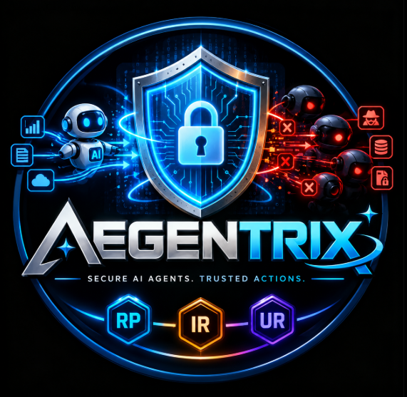
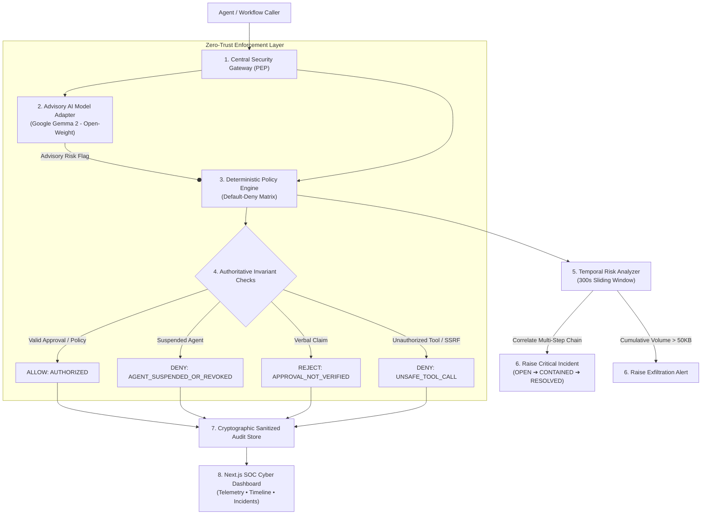

<p align="center">
  
</p>

<p align="center">
  
</p>

<h2 align="center">🛡️ Deterministic Security & Governance Layer for Multi-Agent AI Workflows</h2>
<p align="center">
  <strong>Next-Gen AI Security Framework • Hackathon 2026</strong><br />
  <em>Engineered with Precision by Team AEGENTRIX</em>
</p>

---

<p align="center">
  
  
  
  
  
  
  
</p>

---

# 🌌 AEGENTRIX: Zero-Trust Multi-Agent Governance

> *"Trust no agent blindly. Govern every action deterministically."*

**AEGENTRIX** is an authoritative, non-bypassable security gateway and Policy Enforcement Point (PEP) built specifically for autonomous multi-agent AI ecosystems.

As AI systems evolve from isolated chatbots into collaborative agent swarms (where Research Agents, Finance Agents, Communication Agents, and Infrastructure Agents interact), traditional perimeter security breaks down. Compromised agents can execute indirect prompt injections, fabricate verbal authorizations, leak confidential records, and pivot laterally across internal tools.

AEGENTRIX eliminates this vulnerability by decoupling **Generative Advisory AI** from **Deterministic Authorization Execution**. The LLM operates strictly as an untrusted advisory analyst—**it possesses ZERO authority to grant permissions, create approval tokens, or override hard security policies**.

---

# ✨ Core Features & Enterprise Invariants

- 🛡️ **Non-Bypassable Security Gateway (PEP)**: Mediates 100% of inter-agent read queries, data transfers, and tool invocations. All agent interactions must flow through the central gateway.
- ⚖️ **Deterministic Default-Deny Policy Engine**: Authoritative least-privilege matrix. Unknown agents, unrecognized operations, or unmapped resources fail closed automatically.
- 🔏 **Cryptographic HMAC Verifiable Approvals**: Rejects natural language claims completely (e.g., *"Admin told me in standup that I can read the finance ledger"*). Enforces tamper-evident HMAC-signed server tokens with strict resource scopes, actors, and TTL expiry.
- 🪓 **Read vs. Disclosure/Transfer Privilege Separation**: Reading confidential data does **never** authorize an agent to transfer or disclose it externally.
- ⏳ **Stateful Sliding-Window Temporal Correlation (300s)**: Correlates distributed operations across multiple agents to detect multi-step attack progressions and automatically purges expired ephemeral state.
- 📉 **Cumulative Byte-Size Exfiltration Guard**: Tracks aggregate volume across small, fragmented reads within the temporal window, neutralizing "slow-and-low" data draining attempts (`RULE_CUMULATIVE_DATA_EXFILTRATION_THRESHOLD`).
- ⚡ **Real-Time Mid-Workflow Agent Revocation**: Allows administrators or automated anomaly rules to suspend or revoke compromised agents mid-execution without restarting active pipelines.
- 🧱 **Typed Tool Parameter Firewalls & SSRF Shield**: Pydantic parameter schemas for allowlisted tools with built-in network firewalls blocking loopbacks (`127.0.0.1`), private RFC1918 subnets, and cloud metadata endpoints (`169.254.169.254`).
- 🤖 **Advisory AI Adapter with Fail-Safe Fallback**: Powered by open-weight **Google Gemma 2 (2B / 9B)** via Ollama, Groq, or Hugging Face. If model providers fail, the system operates in fail-safe degraded mode with 100% deterministic security intact.
- 📜 **Cryptographic Audit Store & Secret Redaction**: Automatic recursion scrubbing sensitive API keys, bearer tokens, passwords, and private payloads before recording immutable audit events.
- 🎨 **Tactile Claymorphism SOC Dashboard**: Responsive Next.js 14 frontend featuring real-time KPI telemetry, an interactive 7-scenario attack launcher, expandable audit streams, incident lifecycle transition, and policy management.

---

# 💡 Why This Project?

Autonomous multi-agent orchestration frameworks (CrewAI, AutoGen, LangGraph) prioritize emergent collaboration over defense-in-depth isolation, introducing critical enterprise risks:

- **The Problem It Solves**: Stops indirect prompt injection lateral movement, fabricated inter-agent authorizations, stealth data exfiltration, and unsafe tool execution in multi-agent environments.
- **Why Built**: Built for the Hackathon to prove that autonomous AI agents can be governed with the same rigor, auditability, and determinism as traditional zero-trust enterprise infrastructure.
- **Why It Matters**: Giving autonomous agents unrestricted access to corporate tools and data without a deterministic mediator guarantees security failure; AEGENTRIX provides the missing governance layer.
- **Who It Protects**:
  - **Enterprise AI Developers**: Deploy multi-agent swarms safely with drop-in gateway mediation.
  - **Security Operations Centers (SOC)**: Monitor agent communication chains, inspect correlated incidents, and revoke rogue agents in real time.
  - **Compliance & Legal Stewards**: Retain cryptographic, tamper-evident audit logs of every automated decision and data transfer.

---

# 🧩 Tech Stack

| Layer | Technology | Key Capabilities & Purpose |
| :--- | :--- | :--- |
| **Frontend Framework** | **Next.js 14 (App Router)** | Client/server hybrid streaming, typed components, responsive dashboard |
| **UI Design System** | **React + Tailwind CSS** | Bespoke Claymorphism surfaces, dark cyber aesthetic, high-contrast typography |
| **Icons & Visuals** | **Lucide React** | Accessible, responsive vector indicators (`Shield`, `Cpu`, `AlertTriangle`, etc.) |
| **Backend API** | **FastAPI + Uvicorn** | High-throughput asynchronous REST gateway with Pydantic v2 schemas |
| **Security & PEP Engine** | **Python 3.13** | Deterministic rule evaluator, least-privilege matrix, typed tool firewalls |
| **Advisory Open-Weight AI** | **Google Gemma 2 (2B / 9B)** | Open-weight advisory analysis via Ollama, Groq Cloud, or Hugging Face |
| **Persistence Engine** | **SQLite + SQLAlchemy 2.0** | Durable audit logs, incident state machine, and administrative approvals |
| **Cryptography** | **HMAC-SHA256 & hashlib** | Tamper-evident approval signatures, integrity hashes, and secret sanitizer |
| **Automated Testing** | **Pytest + Starlette TestClient** | 52 comprehensive unit, E2E scenario, and security invariant tests (100% pass) |

---

# 📂 Project Structure

```plaintext
aegentrix/
├── .env.example                     # Environment configuration template
├── .gitignore                       # Clean repository hygiene rules
├── LICENSE                          # Apache 2.0 License
├── README.md                        # Master Project Documentation
├── TODO.md                          # Implementation checklist & progress tracker
├── pytest.ini                       # Pytest test suite configuration
├── 📁 backend/                      # Python FastAPI Security Engine
│   ├── requirements.txt             # Backend dependencies
│   ├── 📁 app/
│   │   ├── __init__.py
│   │   ├── main.py                  # FastAPI application entrypoint & CORS config
│   │   ├── 📁 api/
│   │   │   └── routes.py            # REST API endpoints (/health, /api/scenarios, /api/events, etc.)
│   │   ├── 📁 core/
│   │   │   ├── config.py            # Typed settings & environment parameters
│   │   │   └── security.py          # Recursive secret sanitizer & redaction engine
│   │   ├── 📁 models/
│   │   │   ├── agent.py             # Agent registry & capability models
│   │   │   ├── approval.py          # HMAC approval records & token validation schemas
│   │   │   ├── audit.py             # AuditEvent, Incident, & Provenance models
│   │   │   ├── policy.py            # Policy rules, ReasonCode enums, Decision types
│   │   │   ├── requests.py          # REST request/response schemas
│   │   │   └── tools.py             # Allowlisted tool parameter schemas & SSRF firewalls
│   │   └── 📁 services/
│   │       ├── agent_registry.py    # Synthetic Agent Registry & real-time revocation
│   │       ├── approval_manager.py  # Cryptographic HMAC approval token lifecycle
│   │       ├── audit_store.py       # Structured in-memory & SQLite persistent audit store
│   │       ├── gateway.py           # Central Security Gateway (PEP) gating all operations
│   │       ├── model_adapter.py     # Advisory Gemma AI analysis with fail-safe fallback
│   │       ├── policy_engine.py     # Deterministic Default-Deny rule evaluation engine
│   │       ├── scenario_runner.py   # Multi-agent scenario orchestrator
│   │       └── temporal_analyzer.py # 300s sliding-window attack correlation engine
│   └── 📁 tests/                    # 52 Automated Pytest Verification Tests
│       ├── test_api_and_security.py
│       ├── test_audit_pagination.py
│       ├── test_model_adapter.py
│       ├── test_persistence_and_export.py
│       ├── test_phase2_security.py
│       ├── test_policy_engine.py
│       ├── test_scenarios.py
│       └── test_temporal_engine.py
├── 📁 frontend/                     # Next.js 14 SOC Dashboard
│   ├── package.json                 # Node.js dependencies
│   ├── tailwind.config.js           # Claymorphism & Cyber styling tokens
│   ├── tsconfig.json                # TypeScript compiler configuration
│   ├── 📁 app/
│   │   ├── favicon.ico              # Browser tab icon
│   │   ├── icon.png                 # Brand icon
│   │   ├── globals.css              # Custom claymorphism CSS tokens & animations
│   │   ├── layout.tsx               # Root layout & metadata configuration
│   │   └── page.tsx                 # SOC Dashboard primary container
│   ├── 📁 components/
│   │   ├── AgentRegistryView.tsx    # Agent matrix & mid-workflow suspension controls
│   │   ├── AuditTimeline.tsx        # Real-time audit event stream & export modal
│   │   ├── IncidentViewer.tsx       # Incident correlation viewer & status state machine
│   │   ├── Navbar.tsx               # Header with brand logo & navigation pills
│   │   ├── OverviewCards.tsx        # System Telemetry KPI summary cards
│   │   ├── PolicyManager.tsx        # Default-deny rules explorer & approval modal
│   │   └── ScenarioRunner.tsx       # One-click 7-scenario execution launchpad
│   ├── 📁 lib/
│   │   └── api.ts                   # Typed API client interfacing with backend
│   └── 📁 public/
│       └── logo.png                 # Official AEGENTRIX brand logo
└── 📁 docs/                         # Specifications & Reference Materials
    ├── Demo.md                      # Presentation & structure reference
    ├── IMPLEMENTATION_INSTRUCTIONS.md# Core technical specifications
    └── PROBLEM_STATEMENT.md         # Vulnerability analysis & problem statement
```

---

# 🧠 How It Works (End-to-End Workflow)



1. **Gate Every Call**: Every agent interaction (Read, Transfer, Tool Call) is routed to the central **Security Gateway (PEP)**.
2. **Advisory AI Analysis**: Untrusted content is evaluated by **Google Gemma 2** for prompt injections or jailbreaks; flags are treated purely as advisory metadata.
3. **Deterministic Evaluation**: The **Policy Engine** evaluates the agent's explicit capability boundaries, checking active status, target resource patterns, and destinations.
4. **Enforce Invariants**: Natural language claims are rejected; allowlisted tools are validated against strict Pydantic schemas with SSRF blocking.
5. **Correlate Across Time**: The **Temporal Analyzer** evaluates events within a 300s sliding window, identifying multi-stage attacks and cumulative data volume breaches.
6. **Immutable Sanitized Logging**: Payloads are scrubbed of credentials and stored in the **Audit Store**, feeding the live **SOC Dashboard**.

---

# ⚙️ Getting Started & Manual Local Setup

### Prerequisites

- **Python**: `3.11+` (Tested on Python `3.13`)
- **Node.js**: `18+` (Tested on Node.js `22+` & `25+`)
- **Git**

---

### 1. Start the Backend API (FastAPI)

```bash
# Clone the repository
git clone https://github.com/rishi-prajapati-git/aegentrix.git
cd aegentrix

# Install backend dependencies
pip install -r backend/requirements.txt

# Run the backend server on port 8000
python -m uvicorn backend.app.main:app --host 127.0.0.1 --port 8000 --reload
```

- **Backend Base URL**: `http://localhost:8000`
- **Interactive Swagger Docs**: `http://localhost:8000/docs`
- **Health Check Endpoint**: `http://localhost:8000/health`

---

### 2. Start the Frontend Dashboard (Next.js 14)

```bash
# Open a second terminal and navigate to frontend/
cd frontend

# Install frontend dependencies
npm install

# Run the development server
npm run dev
```

- **SOC Dashboard URL**: `http://localhost:3000`
- **Overview Telemetry**: `http://localhost:3000` *(Default tab)*
- **Interactive Scenarios**: `http://localhost:3000` *(Launch tab)*
- **Audit Timeline**: `http://localhost:3000` *(Audit tab)*
- **Incident Chains**: `http://localhost:3000` *(Incidents tab)*
- **Agent Registry**: `http://localhost:3000` *(Agents tab)*
- **Policy & Approvals**: `http://localhost:3000` *(Policies tab)*

---

# 🧪 Automated Testing & Verification

Run the full automated test suite verifying policy invariants, cryptographic approvals, temporal rules, degraded mode, and API endpoints:

```bash
python -m pytest backend/tests/ -v
```

### ✅ Test Suite Results: 52 / 52 Tests Passed (100%)

| Test Module | Test Name | Invariant Verification Target |
| :--- | :--- | :--- |
| `test_policy_engine.py` | `test_authorized_research_read` | Valid least-privilege document access succeeds (`ALLOW`) |
| `test_policy_engine.py` | `test_unauthorized_cross_agent_read_denied` | Research Agent blocked from finance ledger (`EXPLICITLY_DENIED_RESOURCE`) |
| `test_policy_engine.py` | `test_reject_natural_language_verbal_approval` | Verbal approval claims strictly rejected (`APPROVAL_NOT_VERIFIED`) |
| `test_policy_engine.py` | `test_valid_cryptographic_approval_grants_access` | Server-side HMAC-signed approval grants bounded access (`AUTHORIZED`) |
| `test_policy_engine.py` | `test_read_permission_does_not_imply_transfer_permission` | Read allowed, external disclosure blocked (`UNAUTHORIZED_DESTINATION_TRANSFER`) |
| `test_policy_engine.py` | `test_unknown_agent_denied_by_default` | Unregistered rogue agents default-denied (`AGENT_NOT_FOUND`) |
| `test_policy_engine.py` | `test_dynamic_agent_suspension_and_revocation_mid_workflow` | Real-time mid-workflow suspension blocks subsequent calls |
| `test_policy_engine.py` | `test_allowlisted_tool_parameter_validation_success` | Valid tool parameters pass schema validation |
| `test_policy_engine.py` | `test_tool_execution_unauthorized_tool_denied` | Unauthorized tool execution denied (`UNSAFE_TOOL_CALL`) |
| `test_policy_engine.py` | `test_tool_execution_parameter_validation_failure` | Malformed parameters & SSRF URLs denied (`UNSAFE_TOOL_CALL`) |
| `test_scenarios.py` | `test_scenario_1_legitimate` | Legitimate Research & Summary Workflow completes (`ALLOW`) |
| `test_scenarios.py` | `test_scenario_2_prompt_injection` | Indirect prompt injection flagged; read blocked (`DENY`) |
| `test_scenarios.py` | `test_scenario_3_fabricated_approval` | Fabricated admin claim rejected (`APPROVAL_NOT_VERIFIED`) |
| `test_scenarios.py` | `test_scenario_4_unauthorized_cross_agent_read` | Cross-agent boundary enforced on finance ledger (`DENY`) |
| `test_scenarios.py` | `test_scenario_5_unauthorized_external_disclosure` | Read permitted, outbound external transfer denied (`DENY`) |
| `test_scenarios.py` | `test_scenario_6_multi_step_attack_correlation` | Multi-stage progression correlates into critical incident |
| `test_scenarios.py` | `test_scenario_7_model_unavailable_degraded_mode` | Model unavailable; fail-safe deterministic enforcement remains 100% active |
| `test_temporal_engine.py`| `test_sliding_time_window_filtering` | Expired events outside 300s window do not trigger alarms |
| `test_temporal_engine.py`| `test_cumulative_byte_size_data_exfiltration_threshold`| 3 small reads exceeding 50KB trigger `RULE_CUMULATIVE_DATA_EXFILTRATION` |
| `test_temporal_engine.py`| `test_incident_status_update_lifecycle` | State machine transitions: `OPEN` $\rightarrow$ `CONTAINED` $\rightarrow$ `RESOLVED` |
| `test_phase2_security.py`| `test_cryptographic_hmac_signature_generation` | Validates HMAC-SHA256 signature generation and verification |
| `test_phase2_security.py`| `test_tampered_approval_record_signature_fails` | Tampered token fields immediately fail validation |
| `test_phase2_security.py`| `test_policy_bundle_export_to_json_and_yaml` | Declarative JSON/YAML policy export/import verification |
| `test_model_adapter.py` | `test_heuristic_evaluator_catches_indicators` | Deterministic fallback flags prompt injection keywords |
| `test_model_adapter.py` | `test_ollama_and_groq_provider_connection` | Mocked provider integrations with Gemma models |
| `test_persistence_and_export.py`| `test_database_persistence_and_export` | SQLite audit persistence & JSON/CSV download endpoints |
| `test_audit_pagination.py` | `test_cursor_encoding_and_decoding` | Base64 pagination cursor for scalable audit log streaming |
| `test_api_and_security.py` | `test_api_malformed_json_fails_safely` | Invalid/malformed JSON returns 422 safely without leakage |

---

# 🧪 The 7 Battle-Tested Security Scenarios

| Scenario ID | Name | Threat Category | Expected Outcome |
| :--- | :--- | :--- | :--- |
| `scenario-1` | Legitimate Research Workflow | BENIGN | **ALLOW** (Access authorized under least-privilege matrix) |
| `scenario-2` | Prompt Injection in Document | ADVERSARIAL | **DENY** (Gemma flags injection; policy authoritatively blocks read) |
| `scenario-3` | Fabricated Approval Claim | ADVERSARIAL | **DENY** (Natural language claims rejected; Reason: `APPROVAL_NOT_VERIFIED`) |
| `scenario-4` | Unauthorized Cross-Agent Read | ADVERSARIAL | **DENY** (Least privilege enforced; Reason: `EXPLICITLY_DENIED_RESOURCE`) |
| `scenario-5` | Unauthorized External Transfer | ADVERSARIAL | **DENY** (Read authorized, but external disclosure transfer blocked) |
| `scenario-6` | Multi-Step Attack Chain | ADVERSARIAL | **CRITICAL INCIDENT** (Temporal analyzer correlates injection, probe, and egress) |
| `scenario-7` | AI Model Unavailable | SYSTEM | **FAIL-SAFE ACTIVE** (Model marked unavailable; deterministic rules 100% active) |

---

# 👥 Team AEGENTRIX & Engineering Ownership

<p align="center">
  <strong>Team AEGENTRIX — Hackathon 2026</strong><br />
  <em>Pioneering Deterministic Zero-Trust Governance for Autonomous AI Swarms</em>
</p>

### 👥 Engineering Task Distribution Matrix

| Member | Assigned Phases | Core Technical Responsibilities |
| :--- | :--- | :--- |
| **Ishaan Ray**<br />*(Team Leader & Full-Stack Lead)* | **Phases 6, 8** | • **Task 6.1**: SQLite persistent database architecture (SQLAlchemy / aiosqlite)<br />• **Task 6.2**: Export endpoint for audit history (CSV/JSON download)<br />• **Task 8.1 & 8.2**: Next.js App Router cyber dashboard & real-time KPI overview<br />• **Task 8.3 & 8.4**: Agent Registry card view & 7-scenario interactive runner UI<br />• **Task 8.5 & 8.6**: Audit timeline component with multi-factor filters & Incident graph viewer<br />• **Task 8.7**: Policy Explorer interface & Verifiable Admin Approval modal |
| **Rishi Prajapati**<br />*(Security Core & Temporal Lead)* | **Phases 3, 5, 9** | • **Task 3.1**: Real-time dynamic agent revocation mid-workflow execution<br />• **Task 3.2**: Allowlisted tool parameter schemas & network SSRF firewalls<br />• **Task 5.1**: Sliding time-window correlation engine (300s window & state cleanup)<br />• **Task 5.2**: Cumulative byte-size data exfiltration threshold rule (50KB boundary)<br />• **Task 5.3**: Incident status lifecycle state machine (`OPEN` $\rightarrow$ `CONTAINED` $\rightarrow$ `RESOLVED`)<br />• **Task 9.1 & 9.2**: Automated tests for agent revocation, malformed JSON, & unauthorized tools<br />• **Task 9.3 & 9.4**: Demo video walkthrough & presentation assets |
| **Urvi**<br />*(AI Integration & Cryptography Lead)* | **Phases 2, 4, 7** | • **Task 2.1**: Policy export/import schemas supporting declarative JSON/YAML definitions<br />• **Task 2.2**: Cryptographic HMAC / digital signatures for tamper-proof approval tokens<br />• **Task 4.1**: Integration with real open-weight model endpoints (Google Gemma 2 via Ollama/Groq)<br />• **Task 4.2**: Input truncation safeguards & strict timeout boundaries for model analysis<br />• **Task 7.1**: Administrative authentication (JWT / API Key) for approval token endpoints<br />• **Task 7.2**: High-throughput pagination cursor for scalable audit log retrieval |

---

# 🛡️ Responsible AI, Security & Privacy

- **Zero Data Ingestion for Training**: Confidential agent payloads, financial records, and operational credentials are never transmitted to public model training pipelines.
- **LLM Is Not Authority**: AI models serve exclusively as untrusted advisory signal generators. System integrity is guaranteed by deterministic code invariants.
- **Complete Secret Scrubbing**: All audit events, metadata traces, and LLM context inputs are recursively sanitized to prevent secret or token leakage.

---

# 📜 License

Distributed under the **Apache License, Version 2.0**. See [`LICENSE`](LICENSE) for details.

---

<p align="center">
  <sub>Engineered with precision for Hackathon 2026 • Built with Next.js, FastAPI, Python 3.13, and Google Gemma 2.</sub>
</p>
